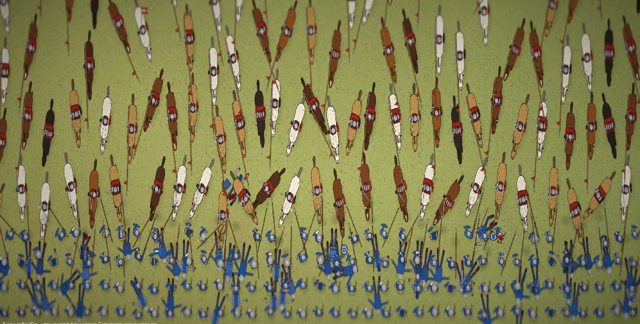
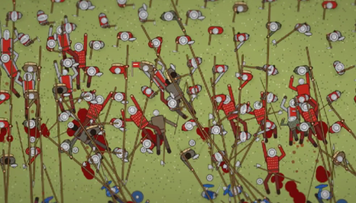
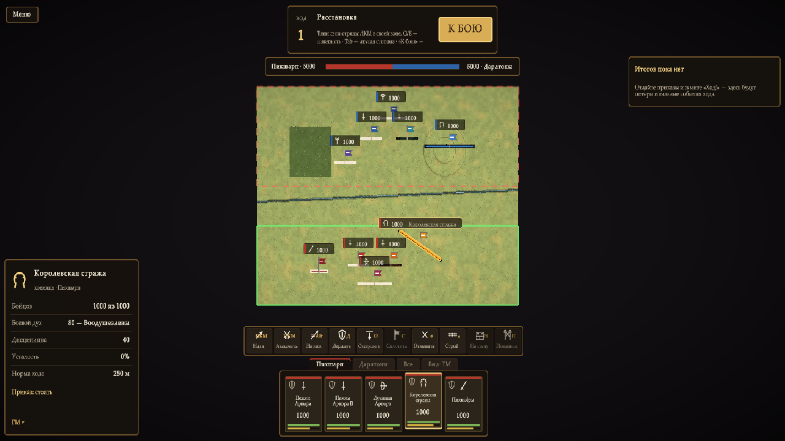
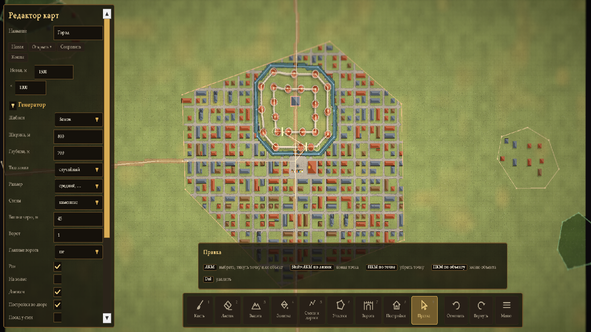
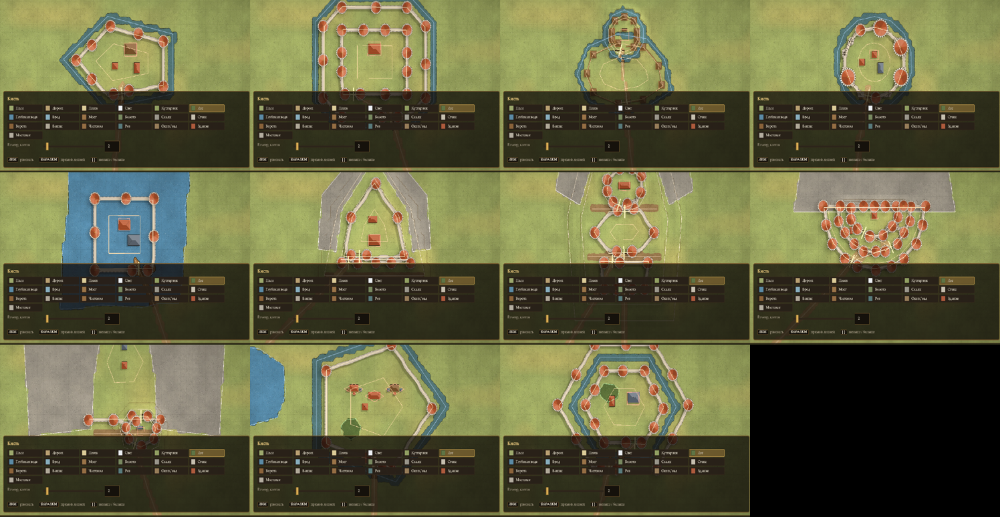
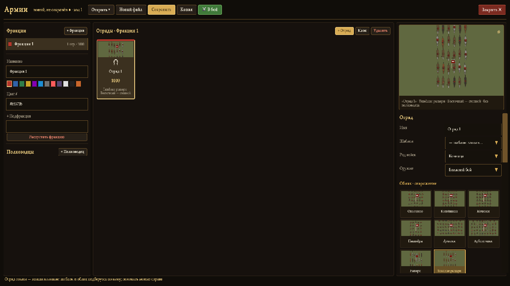

# Журнал боевых действий

Тактическая игра на Unity для массовых сражений кампании «Кодекса Альтера»: десятки тысяч бойцов, осады, паника — и бой, который считается по правилам настольной игры. План — в [`SPEC.md`](SPEC.md), правила работы — в [`CLAUDE.md`](CLAUDE.md).



## О проекте

Пет-проект для нашей команды из 8 игроков: ведущий (ГМ) проводит массовые сражения, а игра считает бой по общим правилам и показывает его вживую. Начат в августе 2026 как HTML-трекер для ГМа, с октября 2026 развивается как игра на Unity.

- **Автор** — Александр Королев ([@Xandret](https://github.com/Xandret)): правила, требования, архитектура, проверка результатов. Код написан в связке с ИИ-ассистентом (Claude): я ставлю задачу и принимаю решения, ассистент пишет код по согласованной спецификации ([`SPEC.md`](SPEC.md)).
- **Масштаб** — около 42 тыс. строк (C# и JavaScript), больше 220 коммитов, игра — версия 0.3.7.
- **Стек** — C# (.NET 10, Unity 6, URP 2D), движок боя без Unity с тестами на .NET; Node 22 для инструментов; Discord API для патчноутов.
- **Качество** — правила боя сверены с настольным эталоном: 400 сценариев — строка в строку, сценарии карты — бит в бит; сотни тестов движка; мерило гладкого движения проверяет каждого бойца и коня по кадрам.
- **Автоматизация** — сборка игры с самопроверкой (`-smoke`), генерация эталонов, публикация патчноутов в Discord ботом, релизы на GitHub.

## Как это выглядит

Ход идёт как за столом: обе стороны отдают приказы, потом 15 секунд боя. Каждый боец — отдельное тело: строй держит места, конница с разбега вламывается в ряды, павшие остаются на поле. Сколько выбыло — по формулам стола, кто именно — решает бой.

| Рукопашная | Расстановка перед боем |
|---|---|
|  |  |

### Крепости и города

Редактор карт с генераторами: 11 типов замков (концентрический, мотт и бейли, водный, на отроге, в ущелье…), города с собором, ратушей и торговыми рядами, деревни. Каждая башня стены — отдельная точка, постройки ставятся поштучно; «Испытать в бою» — сразу битва на этой карте.





### Армии

Редактор армий показывает отряд вживую — в снаряжении, стиле и цвете стороны, с полководцем, свитой и личным стягом. Армии читаются и из сохранений старого трекера (`armiya_hodN.txt`).



## Что умеет

- **Битва от начала до конца:** расстановка в своих зонах → приказы → ход → итог.
- **Приказы:** идти (фронт по протяжке ПКМ), атаковать, натиск, держать, отступить, сплотить, на стену, поединок.
- **Строи:** цепь, линия, глубокий, колонна, клин, полумесяц, каре, круг; разомкнуть и сомкнуть ряды. Отряд сам разворачивается к бою, свои проходят друг сквозь друга, враги — твёрдая стена.
- **Боевой дух и бегство:** проверки после ударов, каскадная паника, преследование, сплочение.
- **Полководцы:** доблесть, свита, личный стяг, поединки командиров.
- **Туман войны и засады:** обзор по местности, вид ГМа или стороны.
- **Крепость:** гарнизон на стенах, ворота открываются и выбиваются, ров и частокол, стрелы застревают в постройках.
- **Для ГМа:** пауза посреди хода, приказы за любую сторону, откат хода, правка отрядов, модификаторы БД, ИИ-помощник («держать», «наступать», «прикрыть», «фланговый манёвр»), адъютант с подсказками и разбором хода.
- **Звук боя** и музыка меню.

Дальше по плану: гонцы и сигналы, колчаны, усталость, местность, погода, пленные, обучающие уроки, осады, игра по сети.

## Скачать

Сборки для Windows и патчноуты — в [релизах](https://github.com/Xandret/battle-tracker/releases).

## Что где

```
game/      игра на Unity: смотрелка боя, экраны, редакторы карт и армий, сборка
core/      движок боя на C# без Unity — пакет для игры и тесты на .NET 10
shared/    эталоны правил стола (golden/), калибровка движка (calibration/), отчёты о битвах (battles/)
docs/      картинки и разборы
tracker/   старый HTML-трекер ГМа — заморожен на v30.11, хранится как архив и источник эталонов
```

## Проверка

```
cd core && dotnet run --project Tests
```
Игра собирается из редактора Unity (меню «Журнал → Собрать игру»); собранный exe проверяет себя ключом `-smoke`.
